# handcursor

Control your computer with one or both hands through the webcam: move the cursor across
all your screens, click, drag, scroll and open apps using gestures. Everything runs
locally, and no video is saved or sent anywhere.
The only network access is a one-time download of MediaPipe's hand model (about 8 MB)
to `~/.cache/handcursor`.

Developed and tested on Windows 11 with Python 3.11.

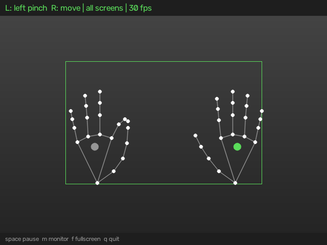

*An illustration of the preview window. The live one draws this over your camera feed.*

## Setup

```powershell
py -3.11 -m venv .venv
.\.venv\Scripts\Activate.ps1
pip install -e ".[dev]"
```

## Run

Try a dry run first. It tracks your hand and prints actions without touching the mouse:

```powershell
handcursor --dry-run
```

Then for real:

```powershell
handcursor
```

## Gestures

| | Gesture | Action |
| --- | --- | --- |
| 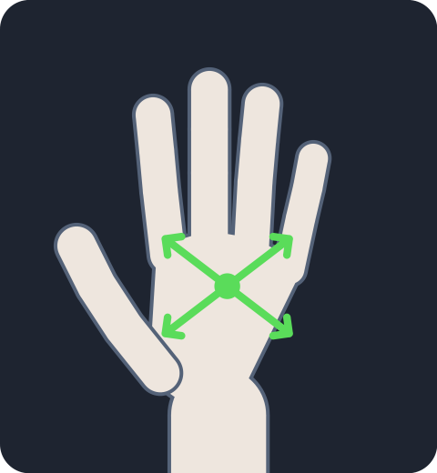 | Open hand (or pointing) | Move the cursor; it follows your palm |
| 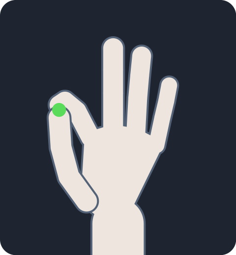 | Thumb + index, quick pinch | Left click (two quick pinches for a double click) |
| 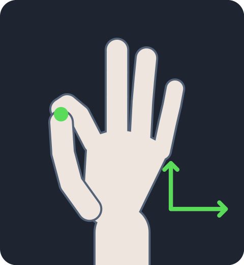 | Thumb + index, hold | Drag until you let go |
| 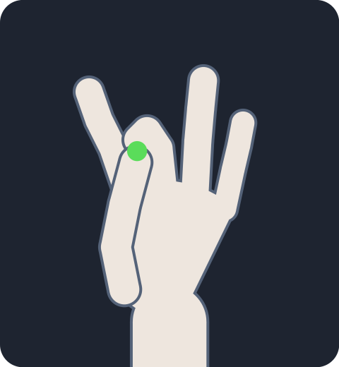 | Thumb + middle, index raised | Right click |
| 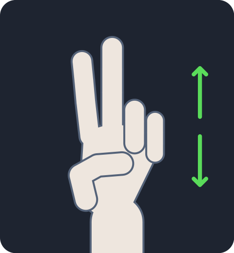 | Index + middle up, others down | Scroll; move your hand up or down |
| 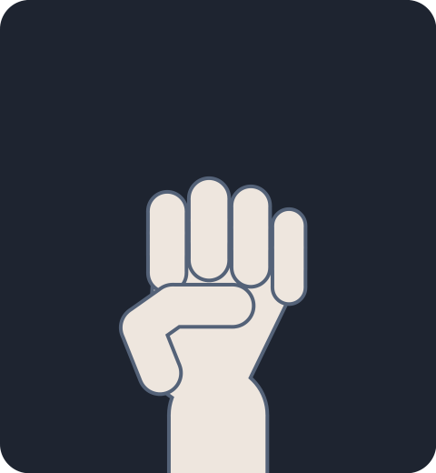 | Fist | Hold the cursor still |
| 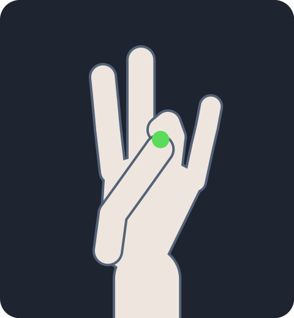 | Thumb + ring, hold ½ second | Open or close the app launcher |
| 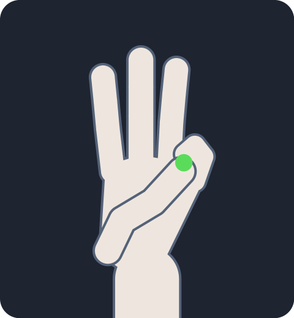 | Thumb + little finger, hold ½ second | Task view, to switch windows |

The cursor follows your palm rather than a fingertip, so it stays where you aimed while
your fingers close. The rectangle in the preview maps to the whole screen, so you only
need to move your palm within it.

### Using both hands

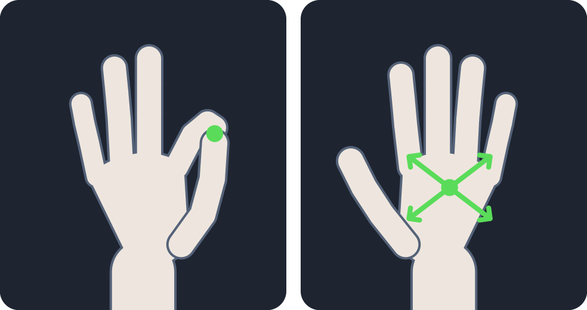

Both hands are tracked at once, and either one can click, drag and scroll. There is only
one cursor, so one hand steers it: your right hand by default, or whichever hand is
visible if there is only one. In the preview, the steering hand has the green palm dot.

This lets you keep moving while the other hand acts:

- Move with your right hand and pinch with your left to click without holding the cursor still.
- Hold a left-hand pinch and steer with your right to drag.
- Scroll with your left hand while your right moves the cursor.

A fist on the steering hand holds the cursor still; on the other hand it does nothing.
Use `--cursor-hand left` to steer with your left hand, or `--hand left` or `--hand right`
to use only one hand and ignore the other.

## Opening apps

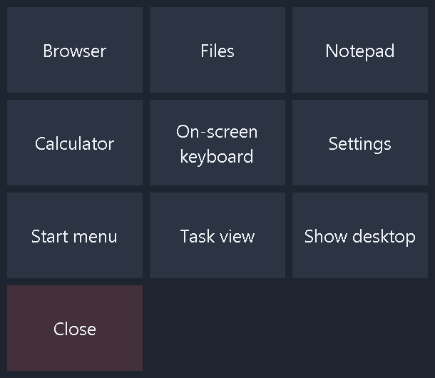

The thumb and ring finger gesture opens a grid of large tiles at the cursor. Move onto a
tile and pinch to choose it. The launcher closes after 20 seconds if you don't. The
On-screen keyboard tile lets you type without touching the keyboard, and you can also
open anything on the desktop or taskbar by pointing and pinching, as with a mouse.

The tiles and both action gestures can be changed in the config file:

```toml
ring_pinch_action = "launcher"
pinky_pinch_action = "open:spotify"

apps = [
    ["Browser", "open:https://www.google.com"],
    ["Downloads", "open:C:/Users/you/Downloads"],
    ["Close window", "keys:<alt>+<f4>"],
]
```

| Action | What it does |
| --- | --- |
| `open:TARGET` | Opens an app, file, folder or URL: anything the Run dialog accepts |
| `keys:COMBO` | Sends a keyboard shortcut, such as `<cmd>+d` or `<ctrl>+<shift>+<esc>` |
| `launcher` | Opens or closes the launcher |
| `none` | Nothing |

## Screens and orientation

By default your hand maps across all your monitors, whatever their arrangement. Where
monitors don't form a neat rectangle, the cursor stops at the edge of the nearest screen
rather than getting lost in a gap. The more screen area one hand movement covers, the
more sensitive it is, so for fine work press `m` to switch to one screen at a time, which
cycles through all screens and then each one.

Portrait and landscape monitors both work, and rotating a monitor or plugging one in is
picked up within a couple of seconds while running. If the webcam itself is turned, as
on a 2-in-1 or a rotated monitor, tell the app with `--camera-rotation 90` (or 180 or 270).

## Controls

| Action | Preview window focused | Anywhere |
| --- | --- | --- |
| Pause / resume | `space` | `Ctrl+Alt+H` |
| Next screen | `m` | `Ctrl+Alt+M` |
| Fullscreen on / off | `f` (`Esc` also exits) | |
| Quit | `q`, or `Esc` when not fullscreen | `Ctrl+Alt+Q` |

The preview window can also be resized or maximized. Fullscreen fills the monitor the
window is on, so if that's also the monitor you're controlling, it covers what you're
trying to click. To avoid that, drag the window to a monitor you aren't using, then press
`m` until you're controlling a different one.

Pausing, quitting or losing sight of your hand for more than a moment always releases a
held drag. If hand control goes wrong, `Ctrl+Alt+H` hands the cursor back to you.

## Options

```
handcursor [--config FILE] [--camera N] [--camera-rotation DEGREES] [--monitor {all,N}]
           [--hand {both,left,right}] [--cursor-hand {left,right}] [--dry-run]
           [--no-preview] [--fullscreen] [--list-monitors]
```

Monitor 0 is always the primary; run `handcursor --list-monitors` to see the others.

To tune behaviour, copy `config.example.toml` to `config.toml`, edit it, and pass
`--config config.toml`. Common adjustments:

| Problem | Setting |
| --- | --- |
| Cursor is jittery | Lower `min_cutoff` |
| Cursor lags behind | Raise `beta` |
| Hand has to move too far | Shrink `region` |
| Clicks fire by accident | Lower `pinch_enter`, raise `stable_frames` |
| Pinches are missed | Raise `pinch_enter` and `pinch_exit` |
| Clicks turn into drags | Raise `drag_hold` |
| Apps open by accident | Raise `action_hold` |
| Scrolling is too fast or slow | Change `scroll_speed` |

## Troubleshooting

- **Clicks do nothing in some windows:** Windows blocks input from a normal program to
  one running as administrator. Run `handcursor` as administrator for those windows.
- **Tracking is unreliable:** use even light on your hand, avoid strong backlight, and
  keep your whole hand in frame with your palm facing the camera. A camera in dim light
  also slows down, which makes the cursor feel laggy.
- **Accidental clicks while typing:** hands near the keyboard can be read as gestures.
  Pause with `Ctrl+Alt+H` while you type.
- **`inference_feedback_manager` or `NORM_RECT` lines at startup:** harmless MediaPipe logging.

## How it works

```
camera.py -> tracker.py -> control.py -> mouse.py
 frames      landmarks      |- gestures.py   landmarks -> pose
                            |- smoothing.py  One Euro filter on the cursor
                            |- screen.py     monitors, and mapping onto them
                            |- actions.py    open apps, send shortcuts
                                 |- launcher.py  the tiles, in their own process
```

`gestures.py` works on MediaPipe's 3D world landmarks with distances relative to palm
size, so gestures don't depend on your hand's size or distance from the camera.
`control.py` is the state machine from poses to mouse actions. Both take their inputs as
plain values, so the tests run without a camera:

```powershell
pytest
```

The images in `docs/images` are drawn by `python scripts/make_readme_images.py`, apart from
`launcher.png`, which is a screenshot of the real launcher.
